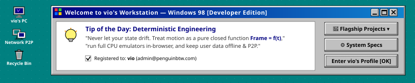
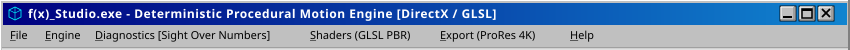
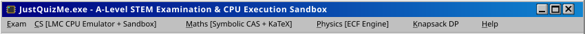
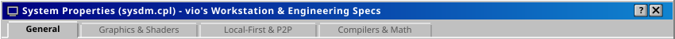

<div align="center">

<!-- ========================================== -->
<!-- WINDOWS 98 DESKTOP HERO BANNER            -->
<!-- ========================================== -->
<a href="#-flagship-applications">
  
</a>

<br/>

<!-- ========================================== -->
<!-- RETRO START MENU (INTERACTIVE ACCORDION)  -->
<!-- ========================================== -->
<details align="left">
<summary><kbd>&nbsp; 🪟 Start &nbsp;</kbd> &nbsp; <b>Program Manager</b> &nbsp; <i>(Click to explore all programs &amp; navigation)</i></summary>

<br/>

| Icon | Program / Shortcut | Path | Action |
| :---: | :--- | :--- | :---: |
| 📝 | **README.TXT** | `C:\WINDOWS\DESKTOP\README.TXT` | [Open Window ↓](#-readmetxt---notepad) |
| 🎬 | **f(x) Studio** | `C:\PROGRAMS\FX_STUDIO.EXE` | [Launch App ↓](#-fx_studioexe---procedural-motion-engine) |
| 🧪 | **JustQuizMe** | `C:\PROGRAMS\JUSTQUIZ.EXE` | [Launch App ↓](#-justquizmeexe---stem-execution-sandbox) |
| 📅 | **When-R-U-Free?** | `C:\PROGRAMS\WHENFREE.EXE` | [Launch App ↓](#-when-r-u-freeexe---local-first-availability-engine) |
| ⚙️ | **System Properties** | `C:\WINDOWS\SYSDM.CPL` | [Inspect Specs ↓](#-system-properties-sysdmcpl) |

<br/>
</details>

</div>

<br/>

<!-- ========================================== -->
<!-- WINDOW 1: README.TXT (NOTEPAD)            -->
<!-- ========================================== -->
<div align="center">
  <a name="-readmetxt---notepad"></a>
  
</div>

```
File: C:\WINDOWS\DESKTOP\README.TXT | User: vio (@PenguinBTW) | Status: Read-Only
--------------------------------------------------------------------------------
"If an animation can be expressed as a closed math formula Frame = f(t), never
let state drift. If user data is personal, keep it strictly on-device. If
students are revising complex STEM, give them interactive compilers, not flashcards."
--------------------------------------------------------------------------------
```

#### 👨‍💻 Engineering Philosophy & Focus

I engineer high-performance software at the intersection of **low-level graphics math**, **local-first privacy-preserving systems**, and **interactive STEM tooling**. Rather than relying on generic boilerplate, I focus on deterministic pipelines, hardware-accelerated shaders, and discrete optimization algorithms:

* 📐 **Deterministic Graphics & Math:** Closed-form ODE spring dynamics, Catmull-Rom splines, procedural GLSL PBR materials, and headless 60fps GPU frame streaming.
* 🔒 **Local-First & Offline-First:** Zero-cloud architectures, optical QR peer-to-peer data interchange, encrypted storage, and OAuth 2.0 PKCE.
* ⚙️ **Compilers & Simulations:** In-browser sandboxed code runners, Little Man Computer (LMC) 100-mailbox CPU emulators, symbolic algebra systems (CAS), and dynamic programming knapsack solvers.

<br/>

<div align="center">
  <a href="https://github.com/PenguinBTW?tab=repositories"><kbd>&nbsp;&nbsp; 📁 View All Repositories ↗ &nbsp;&nbsp;</kbd></a> &nbsp;
  <a href="#-system-properties-sysdmcpl"><kbd>&nbsp;&nbsp; ⚙️ System Specs &nbsp;&nbsp;</kbd></a> &nbsp;
  <a href="mailto:admin@penguinbtw.com"><kbd>&nbsp;&nbsp; ✉️ Contact vio &nbsp;&nbsp;</kbd></a>
</div>

<br/>

<div align="center">
  
</div>

<br/>
<hr/>
<br/>

<!-- ========================================== -->
<!-- WINDOW 2: f(x) Studio                      -->
<!-- ========================================== -->
<div align="center">
  <a name="-flagship-applications"></a>
  <a name="-fx_studioexe---procedural-motion-engine"></a>
  
</div>

> **Address:** `C:\PROGRAMS\FX_STUDIO.EXE` &nbsp;|&nbsp; **Architecture:** `Deterministic Closed-Form Engine` &nbsp;|&nbsp; **Runtime:** `Bun / WebGL2`  
> A deterministic, code-first procedural motion design engine and visual diagnostic inspection suite built for autonomous AI agents and technical motion designers.

```
Input (Audio FFT, Keyframes, Time)
  └── Universal Closed-Loop [Frame = f(t)]
        ├── CompositorGraph (HalfFloat HDR, Procedural GLSL PBR Shaders)
        ├── Sight-Over-Numbers Diagnostics (4 Single-Still Diagnostic Plates)
        └── Headless 60fps GPU Pipeline (Playwright rawvideo ──► NVENC FFmpeg ProRes 4444)
```

#### 🔬 "Sight Over Numbers" — The 4 Diagnostic Instruments
AI coding agents are fundamentally blind to visual animation. Feeding them 1,800 video frames burns tokens and causes temporal blur. **f(x) Studio** compresses complex spatial and temporal motion into **4 single-still diagnostic images**:

| Instrument | Visual Encoding | Glitch Diagnosed in a Single Still |
| :--- | :--- | :--- |
| 🧅 **Multi-Exposure Motion Onion** | Chromatic decay (`cyan → natural → amber`) | Easing micro-jitter, spring damping oscillations |
| 📐 **3D God-View Blueprint** | Orthographic flight ribbons (`XZ` & `YZ`) | Frustum near-plane clipping & 3D spatial collisions |
| ⚖️ **Visual A/B Reference Anchor** | Side-by-side & 45° diagonal split-wipe | Spatial drift against source Figma artboards |
| 🪡 **Transition Seam Inspector** | Head-to-tail false-color filmstrip (±250ms) | Carrier object alignment & velocity continuity |

#### ⚡ Core Engineering Highlights
* **Temporal Determinism (`Frame = f(t)`):** Zero mutable accumulator drift (`pos += vel * dt`). Every single property is evaluated as a pure function of timeline time t, enabling perfect sub-frame supersampling and zero-artifact offline 4K rendering.
* **Studio-Grade Optics:** Custom GLSL Ward anisotropic brushed metal, wireframe edge glow, optical Depth of Field (DoF), and frosted Fresnel glass.
* **Audio Intelligence & GPU Pipe:** Python (`Librosa` / `SciPy`) transient envelopes synchronize typography beat-by-beat, streamed headless via Playwright into hardware-accelerated FFmpeg for ProRes 4444 with alpha.

<br/>

<div align="center">
  <a href="https://github.com/PenguinBTW/fx-studio"><kbd>&nbsp;&nbsp; 🚀 Launch f(x) Studio Repo ↗ &nbsp;&nbsp;</kbd></a> &nbsp;
  <a href="https://github.com/PenguinBTW/fx-studio#diagnostics"><kbd>&nbsp;&nbsp; 🔬 View Diagnostic Plates &nbsp;&nbsp;</kbd></a> &nbsp;
  <a href="https://github.com/PenguinBTW/fx-studio#whitepaper"><kbd>&nbsp;&nbsp; 📜 Architecture Whitepaper &nbsp;&nbsp;</kbd></a>
</div>

<br/>

<div align="center">
  
</div>

<br/>
<hr/>
<br/>

<!-- ========================================== -->
<!-- WINDOW 3: JustQuizMe                      -->
<!-- ========================================== -->
<div align="center">
  <a name="-justquizmeexe---stem-execution-sandbox"></a>
  
</div>

> **Address:** `C:\PROGRAMS\JUSTQUIZ.EXE` &nbsp;|&nbsp; **Platform:** `UK A-Level STEM Workstation` &nbsp;|&nbsp; **Syllabus:** `OCR CS, OCR Maths, AQA Physics`  
> A dedicated, interactive examination and revision platform for UK Sixth Form students that replaces static flashcards and manual mark schemes with subject-specific execution engines.

```
┌────────────────────────────── JustQuizMe Engine Architecture ──────────────────────────────┐
│ [1] OCR Computer Science : 100-Mailbox LMC CPU Emulator + In-Browser C# Code Sandbox       │
│ [2] OCR Mathematics      : Symbolic CAS Engine (Equivalent Math) + KaTeX Live Keypad       │
│ [3] AQA Physics          : Tolerance-Aware Numerical Grading + Error Carry-Forward (ECF)   │
│ [4] Custom Synthesizer   : Dynamic Programming 0/1 Knapsack Solver for Custom Target Exams │
└────────────────────────────────────────────────────────────────────────────────────────────┘
```

#### 🧪 Interactive Subject Engines

| Subject Portal | Execution Engine | Traditional Revision Flaw Solved |
| :--- | :--- | :--- |
| 💻 **OCR Computer Science (H446)** | 100-Mailbox LMC CPU Emulator & C# Sandbox | Replaces dry algorithm memorization with live register inspection and trace tables |
| 📐 **OCR Mathematics (H240)** | Symbolic CAS & Live KaTeX Keypad | Symbolically verifies equivalence: `2(x + 3) ≡ 2x + 6 ≡ 6 + 2x` without string matching |
| ⚛️ **AQA Physics (7408)** | Tolerance Grading & Error Carry-Forward (ECF) | Prevents Step 1 arithmetic slips from invalidating correct subsequent method marks |
| 🎒 **Knapsack Synthesizer** | Dynamic Programming 0/1 Knapsack Solver | Generates custom-fit exams to exact topic mixes and minute/mark limits (e.g. 25 marks) |

#### ⚡ Core Engineering Highlights
* **Computer Science Sandbox:** Complete Little Man Computer (LMC) virtual CPU with program counter, accumulator, and flag register inspection, paired with interactive dry-run trace tables and logic gate toggles.
* **Symbolic Math CAS:** Step-by-step milestone reasoning for Proof by Induction, Contradiction, and Exhaustion, awarding formal M₁ (method) and A₁ (accuracy) marks.
* **Physics Precision:** Over 300 high-resolution diagram crops (circuits, particle tracks, diffraction patterns) with tolerance range verification (e.g. `8.75 ≤ x ≤ 8.85`).

<br/>

<div align="center">
  <a href="https://github.com/PenguinBTW/JustQuizMe"><kbd>&nbsp;&nbsp; 🔬 Open JustQuizMe ↗ &nbsp;&nbsp;</kbd></a> &nbsp;
  <a href="https://github.com/PenguinBTW/JustQuizMe#lmc-emulator"><kbd>&nbsp;&nbsp; 💻 Run LMC CPU Simulator &nbsp;&nbsp;</kbd></a> &nbsp;
  <a href="https://github.com/PenguinBTW/JustQuizMe#knapsack-engine"><kbd>&nbsp;&nbsp; 🎒 Knapsack Algorithm Spec &nbsp;&nbsp;</kbd></a>
</div>

<br/>

<div align="center">
  
</div>

<br/>
<hr/>
<br/>

<!-- ========================================== -->
<!-- WINDOW 4: When-R-U-Free?                   -->
<!-- ========================================== -->
<div align="center">
  <a name="-when-r-u-freeexe---local-first-availability-engine"></a>
  
</div>

> **Address:** `C:\PROGRAMS\WHENFREE.EXE` &nbsp;|&nbsp; **Platform:** `Flutter 3 Mobile (iOS / Android / Web)` &nbsp;|&nbsp; **Cloud:** `0% (Local-First)`  
> A local-first, privacy-focused Flutter mobile application for students to compare weekly timetables and instantly discover shared free breaks without group chat screenshot chaos.

```
┌────────────────────────────── When-R-U-Free? Pipeline ──────────────────────────────┐
│ [On-Device Encrypted Database] ◄── (Direct OAuth 2.0 PKCE) ──► [Microsoft 365 API]  │
│            ▲                                                                        │
│            └── (P2P High-Density QR Transfer / Zero Cloud) ──► [Peer Scanner]       │
│                        │                                                            │
│                        ▼                                                            │
│       [Smart Availability Engine: Intersection & Compact Skip Timeline]             │
└─────────────────────────────────────────────────────────────────────────────────────┘
```

#### 📅 Local-First Capabilities

| Capability | Architectural Implementation | Privacy & Performance Guarantee |
| :--- | :--- | :--- |
| 🛡️ **Zero-Cloud Architecture** | 100% on-device JSON persistence | Timetables never touch an external server or third-party database |
| 📲 **Optical P2P Sync** | Dynamic high-density camera QR scanner | Direct device-to-device timetable exchange in seconds without network routing |
| 🔑 **M365 Direct Auto-Import** | Read-only OAuth 2.0 PKCE in-app | Client credentials & student schedules never leave the physical device |
| ⏱️ **Smart Availability Engine** | Interval intersection & skip dividers | Compacts lesson blocks into skip dividers, ranks top shared meetups |
| 🧪 **Verified Reliability** | 58 Automated unit & widget tests | 100% pass rate with zero static analysis warnings |

#### ⚡ Core Engineering Highlights
* **Proportional Skip Timeline:** Shared free blocks scale visually with duration, while multi-hour lesson periods automatically collapse into compact skip dividers.
* **On-Device Gap Alerts:** Background push notifications scheduled locally on the device 0–30 minutes before upcoming breaks, naming which friends are free.
* **Zero Overhead Transfer:** Share timetables offline via camera QR scan or copy-paste text tokens for messaging apps.

<br/>

<div align="center">
  <a href="https://github.com/PenguinBTW/When-R-U-Free"><kbd>&nbsp;&nbsp; 📱 Launch Mobile Repo ↗ &nbsp;&nbsp;</kbd></a> &nbsp;
  <a href="https://github.com/PenguinBTW/When-R-U-Free#security"><kbd>&nbsp;&nbsp; 🔐 View P2P Security Model &nbsp;&nbsp;</kbd></a> &nbsp;
  <a href="https://github.com/PenguinBTW/When-R-U-Free#tests"><kbd>&nbsp;&nbsp; 🧪 58/58 Test Suite Log &nbsp;&nbsp;</kbd></a>
</div>

<br/>

<div align="center">
  
</div>

<br/>
<hr/>
<br/>

<!-- ========================================== -->
<!-- WINDOW 5: SYSTEM PROPERTIES (SYSDM.CPL)    -->
<!-- ========================================== -->
<div align="center">
  <a name="-system-properties-sysdmcpl"></a>
  
</div>

#### ⚙️ Developer System Specifications

| System Parameter | Specifications & Polyglot Tooling |
| :--- | :--- |
| 👤 **Operator & Handle** | **vio** ([@PenguinBTW](https://github.com/PenguinBTW)) |
| ✉️ **Contact Channel** | [`admin@penguinbtw.com`](mailto:admin@penguinbtw.com) |
| ⚡ **Primary Languages** | `TypeScript` · `Dart` · `GLSL` · `Python` · `C#` · `Pseudocode / LMC Assembly` |
| 🎮 **Graphics & Video** | `WebGL2` · `Three.js` · `GLSL PBR` · `HalfFloat HDR` · `Playwright rawvideo` · `FFmpeg NVENC` |
| 📱 **Mobile & Systems** | `Flutter 3 (Material 3)` · `Provider` · `OAuth 2.0 PKCE` · `flutter_secure_storage` · `mobile_scanner` |
| 📐 **Math & Solvers** | Closed-Form ODE Springs · Catmull-Rom Splines · Symbolic CAS · Dynamic Programming (0/1 Knapsack) |
| 🛠️ **Runtimes & Tooling** | `Bun` · `Node.js` · `Git` · `VS Code` · `KaTeX / LaTeX` |
| 💡 **Core Philosophy** | Pure determinism (`Frame = f(t)`) · Local-first privacy · Interactive simulation over static memorization |

<br/>

<div align="center">
  <a href="https://github.com/PenguinBTW?tab=repositories"><kbd>&nbsp;&nbsp; 📂 Browse Source Code ↗ &nbsp;&nbsp;</kbd></a> &nbsp;
  <a href="mailto:admin@penguinbtw.com"><kbd>&nbsp;&nbsp; ✉️ Open Communications &nbsp;&nbsp;</kbd></a>
</div>

<br/>

<div align="center">
  
</div>

<br/>

<div align="center">

<!-- ========================================== -->
<!-- WINDOWS 98 TASKBAR FOOTER                 -->
<!-- ========================================== -->
<a href="#-readmetxt---notepad">
  
</a>

<br/>

<sub>Microsoft, Windows 98, and DirectX are trademarks or registered trademarks of their respective owners. Powered by deterministic math &amp; local-first engineering. &copy; 1998–2026 vio (@PenguinBTW).</sub>

</div>
